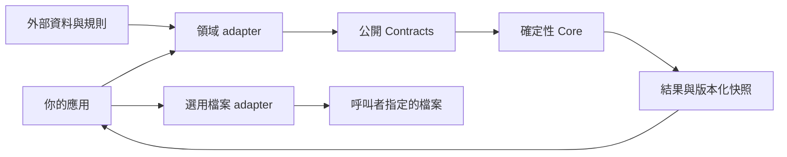

# ARCI · Autonomous Resilient Communication Intelligence

ARCI 研究在資訊不完整、來源衝突與執行不確定時，如何讓判斷保留依據、未知狀態與權限界線。名稱沿用原研究，不改寫縮寫含義。

這個儲存庫現在提供**可獨立安裝的確定性判斷核心 `@arci/core`**：把結構化事實、版本化來源快照與外部規則轉成 `PASS`／`FAIL`／`UNKNOWN`，並保留可檢查的歷史輸入。它適合成為不同應用的條件判斷元件；不會替使用者執行派送、部署或模型推論。

> 本次基線是 generic 0.2 候選的抽離與修補，套件版本為 **0.3.0**。通訊引擎、Core V2／V2.1、SEA V3／V4 是不同研究路線，沒有宣稱已合併成單一系統。

## 1. 核心已具備什麼

- 六種確定性比較運算、嚴格輸入 schema、JSON 大小／深度限制。
- 缺事實、缺證據、來源版本不明或衝突時保留 `UNKNOWN`；`0`／`false` 不視為缺值。
- 來源內容 hash、快照、輸入 hash、逐條理由與稽核；本輪新增規則集 ID／版本／hash、引擎版本與離線重放封套。
- 判斷與權限分離：`PASS → ELIGIBLE`，但一律 `NOT_DISPATCHED`、`NOT_ESTABLISHED`。
- 選用 Node 檔案 adapter：revision 檢查、保存／讀回驗證、寫入鎖、容量限制與先封存再清空。

來源引用只能證明片段存在，不能證明資料真實或規則解讀正確。模型形狀的建議只能作為資料；它不能改寫核心限制或取得執行權。[能力與限制](docs/LIMITATIONS.md)

## 2. 架構



`src/core` 不反向依賴應用或 adapter。根入口與 `/core` 都是純判斷入口；只有顯式使用 `/adapters/file-store` 並建立 repository 時才讀取呼叫者指定的檔案。[架構與依賴檢查](docs/ARCHITECTURE.md)

## 3. Quick Start

需要 Node.js **24** 與 npm **10**（本輪驗證版本見驗證文件；package 最低宣告 Node 22.13，macOS arm64 與 Ubuntu CI 已驗證，其他平台／版本尚未資格化）。

```sh
git clone https://github.com/Yuz1ove/ARCI.git
cd ARCI
npm ci --ignore-scripts
npm run build
npm run example:minimal
npm test
```

最小範例輸出 `PASS`、`NOT_DISPATCHED`、`NOT_ESTABLISHED`。不需要 API key、網站、模型、原專案資料庫或本機掛載。安裝依賴（包含驗收中的外部 consumer 安裝）需要 npm 網路或完整快取；範例本身離線執行。

完整驗收：

```sh
npm run verify
```

`verify` 包含型別、建置、測試、傳遞依賴、文件、三個範例，以及在 workspace 外安裝本次 tarball 的 consumer 驗證。未發布 npm registry；`private: true` 防止意外 registry 發布，仍可打包：

```sh
npm pack --ignore-scripts
```

在另一個專案使用 `npm install /path/to/arci-core-0.3.0.tgz --ignore-scripts`；路徑請換成實際打包產物。程式使用下列公開 import，不必深層匯入。

## 4. 真實 API 範例

<!-- executable:minimal -->
```js
import {createSource, createSnapshot, evaluateVersioned, known} from '@arci/core';

const snapshot = createSnapshot([createSource({
  sourceId: 'synthetic-policy-v1', documentId: 'synthetic-policy', versionId: '1',
  contentType: 'application/json', importedAt: '2026-01-01T00:00:00.000Z',
  content: {limit: 5},
})]);
const result = evaluateVersioned({
  context: {}, facts: {count: known(3)}, selectedSources: ['synthetic-policy-v1'],
  parameters: {}, requestedOperation: 'EVALUATE',
}, snapshot, {
  id: 'count-limit', version: '1', constraints: [{
    id: 'maximum', field: 'count', operator: 'LESS_OR_EQUAL', expected: known(5),
    source: [{sourceId: 'synthetic-policy-v1', versionId: '1', path: 'limit'}],
  }],
});
console.log(JSON.stringify({
  status: result.decision.status,
  executionStatus: result.decision.executionStatus,
  completionStatus: result.decision.completionStatus,
  ruleVersion: result.ruleset.version,
}, null, 2));
```

程式與 [examples/minimal.mjs](examples/minimal.mjs) 保持一致，文件檢查會執行此片段。`replayEvaluation(savedEnvelope)` 僅使用封套中的歷史輸入、來源、規則與支援的引擎版本。[完整 API、錯誤與版本契約](docs/API.md)

## 5. 同一核心的兩種情境

| 情境 | 外部 adapter／規則 | 執行 |
|---|---|---|
| 合成庫存檢查 | 數量與來源中的最低存量 | `npm run example:inventory` |
| 合成軟體發布條件 | 測試失敗數、審查事實與來源規則 | `npm run example:release` |

兩者都依序示範 `PASS`、`FAIL`、`UNKNOWN`，共用同一份 `evaluateVersioned`，並驗證 JSON 存取後可重放。發布條件通過也不會部署軟體。[範例與主題版本關係](docs/EXAMPLES.md)

## 6. 接入自己的 adapter

實作公開 `ArciDomainAdapter<T>` 的 `validateInput`、`normalizeInput` 與 `buildConstraints`，由 host 呼叫核心。把領域名稱、門檻、資料來源與規則放在 adapter／設定；缺值用 `unknown(reason)`，不要補造事實。可參考 [inventory adapter](examples/adapters/inventory.mjs) 與 [接入指南](docs/ADAPTERS.md)。

已實作：兩個合成領域 adapter、選用檔案保存 adapter。僅介面：`ArciDomainAdapter<T>`。模型、雲端資料庫、通訊傳送 adapter 未包含在這個套件，不是預設隱藏服務。

## 7. 驗證與限制

來源基線在本輪先跑 **35 項通過**，原 35 項斷言全部保留並指向抽離後核心。本輪最終 **49 項通過**，包括版本重放、缺證據反例、兩情境與封包驗證；公開 URL 全新 clone 與 Ubuntu CI 均通過。[本輪環境、命令、退出碼、實際結果](docs/VALIDATION.md)

本輪修復「規則沒有任何證據引用仍可 PASS」：現在為 `UNKNOWN / EVIDENCE_REFERENCE_MISSING`，引擎版本 `generic-0.3-evidence-v1`。這是明示的相容性改變，舊版無引用 PASS 不會默默升級為已驗證紀錄。

本套件沒有執行器；取消、遠端逾時、provider acceptance、DB commit 與驗證送達属于其他版本的邊界。沒有現場部署、醫療效能或真實模型準確率宣告。檔案 hash 不等於簽章；檔案鎖不是分散式交易。[已知限制](docs/LIMITATIONS.md)

## 8. 研究來源與其他版本

| 儲存庫／候選 | 本輪定位 |
|---|---|
| [原研究主庫](https://github.com/Yuz1ove/Autonomous-Resilient-Communication-Intelligence)（私人） | 通訊、Core V2、治理與研究模組的來源；權限與公開狀態未更動 |
| 本機 2026-10-03 generic 修補候選 | 本輪核心來源；原來未完整推送到公開 ARCI |
| [ARCI-Presidential](https://github.com/Yuz1ove/ARCI-Presidential) | 主題衍生版本；未遷移至本套件 |
| [ARCI-SEA](https://github.com/Yuz1ove/ARCI-SEA) | 商務網路與 V3 路線；本機 V4 尚有未提交內容，未遷移至本套件 |

初查公開 `main` 只有 README 的情況已確認，前次完整 publication 副本與 commit 只在本機。本輪延續既有公開 Git 歷史，精選核心與測試，不鏡像私人整庫或其 Git history。逐檔來源 repository、commit／候選、原路徑、新路徑與理由見 [來源沿革](docs/PROVENANCE.md) 與 [source map](docs/evidence/source-map.json)。

## 9. 作者與使用範圍

作者／專案帳號：[Yuz1ove](https://github.com/Yuz1ove)。本庫可公開閱讀，本輪未新增 MIT 或其他自有軟體授權。第三方依賴保留各自授權，詳見 [第三方聲明](THIRD_PARTY_NOTICES.md)。AI 輔助整理與測試不能單獨證明每一行歷史程式的作者歸屬。

## English introduction

ARCI (Autonomous Resilient Communication Intelligence) studies evidence-aware decisions under incomplete information and uncertain execution. This repository ships a standalone deterministic TypeScript core with explicit UNKNOWN states, versioned snapshots and rules, offline replay, an optional file store, and two synthetic adapters. Conditions passing never grants execution or establishes completion. Communication, Core V2/V2.1 and SEA variants remain separate research implementations; no field deployment or cross-product migration is claimed.
