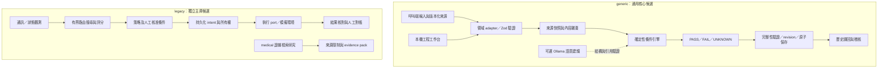

# ARCI · Autonomous Resilient Communication Intelligence

**研究在資訊不完整、來源衝突與執行失敗時，如何讓決策保留依據、權限界線與可追溯狀態。**

這是 Yuz1ove 的研究原始碼與工程證據展示，供技術審查及陽明交通大學百川學程備審參考。公開版整理既有成果，沒有重新開發系統，沒有把模擬或模型建議當成真實任務完成。

> **版本界線：**本庫展示 2026-10-03 的兩份獨立修補候選，於 2026-10-09 重新驗證。`generic` 是通用判斷核心；`legacy` 是原通訊／V2.1／medical 主庫修補。兩者均**未套用原研究服務**，API 與資料結構不混用。來源、commit 關係及公開差異見 [PROVENANCE](docs/PROVENANCE.md)。

[驗證與失敗紀錄](docs/VALIDATION.md) · [程式碼導覽](docs/CODE_GUIDE.md) · [研究歷程](docs/RESEARCH.md) · [備審文字](docs/BAICHUAN.md)

## 研究動機與問題

早期架構以不穩定環境中的通訊路由為起點：網路狀態、電量、任務優先級改變時，系統應重新比較方案；送出請求後，也不能直接把「被接受」當成「已送達」。後續將共通問題抽離為結構化核心：文件來源是否有版本？條件是否足夠？缺少證據時能否保持 UNKNOWN？保存與重開是否仍使用當時的輸入？

這些問題的研究價值在於可檢查的失敗邊界。使用者能看見決策採用的條件與證據，也能區分判斷、准入、派送及完成。這是對原架構與程式的歸納；未據此增寫個人事件或臨床動機。

## 系統架構



兩個子圖是不同版本產品，圖中沒有假設跨版本串接。通用核心的 PASS 固定保留 `executionStatus=NOT_DISPATCHED`、`completionStatus=NOT_ESTABLISHED`；它不自行派送。

## 實作範圍與主要模組

| 狀態 | 成果與證據 | 界線 |
|---|---|---|
| **Implemented** | [generic Core](packages/generic/src/qa/core)：契約、明確未知值、條件比較、來源版本與快照 | 確定性規則；不保證輸入真實 |
| **Implemented** | [保存完整性](packages/generic/src/qa/core/persistence.ts)：revision、writer lock、fsync、容量、先封存後清空 | 單機檔案協調；hash 不是簽章 |
| **Implemented** | [StarryLink adapter](packages/generic/src/qa/adapters/starrylink) 與 [工作台](packages/generic/src/qa/workbench)：輸入、版本選擇、保存與重開 | 合成情境，不是救災實測 |
| **Implemented** | [legacy 路由](packages/legacy/src/routing)：有界深度搜尋、多因素評分、策略驗證與 ACK 邊界 | 圖模型及模擬；非電信設備整合 |
| **Implemented** | [V2.1 coordinator](packages/legacy/src/core-v2/production-cycle.ts)：唯一 intent、派送所有權、核准重驗、結果對帳 | mock／合成回歸；真實 DB race 未驗收 |
| **Implemented** | [非同步邊界](packages/legacy/src/foundations/async-boundary.ts)：期限、取消、共享 lane | 忽略 abort 的工作仍占用 lane |
| **Experimental** | [semantic](packages/generic/src/qa/semantic)：Ollama relevance/support 建議、schema 與原文引用核對 | 模型建議未校準，不能覆寫 hard constraints |
| **Experimental** | [medical](packages/legacy/src/medical)：攝取、去重、混合檢索、來源撤銷與 evidence pack | 合成資料；無臨床或病患成果 |
| **Planned** | 真實外部專案接入、跨程序資源治理、durable tombstone／安全 epoch rollover | 尚未完成，不列為既有成果 |
| **Known Limitations** | 歷史測試路徑失效、外部 DB／模型與現場驗收缺口 | 詳見下方與驗證文件 |

主要技術：TypeScript、Node.js、Zod、React、Vite、Vitest；PostgreSQL adapter 使用 `pg`，可選本機模型使用 Ollama。沒有以套件存在推論已完成真實服務整合。

## 實際資料與決策流程

1. 呼叫端或 adapter 提供 facts、來源 ID／版本、適用條件；未知與零值分開表示。
2. 建立來源快照，核對來源選取、內容 hash 與引用路徑。
3. 執行確定性比較。條件不符為 FAIL；缺值、無版本或無可用條件保留 UNKNOWN。
4. 可選語意模組僅提供受 schema、來源 ID 與原文片段限制的建議；不可授予執行權。
5. 保存時重驗 decision／input／snapshot／audit 關聯，使用 revision 與檔案鎖防止覆寫。
6. 重開歷史結果保留原 snapshot。legacy 執行流程另有 intent／outcome 與核准契約，不由 generic 工作台啟用。

## 技術特色

- **將可判斷與可執行拆開：**通過條件不等於已派送、已送達或任務完成。
- **保留未知：**缺證據不補成肯定結論，版本不明不依檔案日期推定可信。
- **以反例驗證保存與恢復：**測試偽造 PASS、稽核破壞、revision 衝突、封存失敗、遺失 ACK 與遲到結果。
- **抽離可重用核心：**`/core` 的傳遞依賴不含 Node 檔案或模型能力；領域規則、保存與模型 adapter 分開。

這些是本專案的設計與工程成果，未主張學術首創、通用自主智慧或優於既有系統的效能。

## 真實測試與實驗證據

2026-10-09，macOS arm64、Node **24.19.0**、npm **10.9.4**，依兩個 lockfile 乾淨安裝，Vitest 每次最多一個 worker；資料為合成 fixture／mock。

| 驗證 | 實際結果 | 來源 |
|---|---:|---|
| generic 原修補驗收範圍 | **113 通過，0 失敗** | [JSON](docs/evidence/generic-exact-tests.json) |
| legacy 原修補驗收範圍 | **114 通過，0 失敗** | [JSON](docs/evidence/legacy-exact-tests.json) |
| generic 擴大回歸 | **267 通過，1 失敗** | [JSON](docs/evidence/generic-regression.json) |
| generic 本機 HTTP／逾時 | **7 通過，0 失敗** | [JSON](docs/evidence/generic-http-tests.json) |
| 兩產品 typecheck／build | 通過；legacy 首次受沙箱 IPC 限制，授權後重跑通過 | [驗證紀錄](docs/VALIDATION.md) |
| generic 六個建置入口 | 匯入成功；攔截到的 fetch 呼叫 **0** | [摘要](docs/evidence/verification-summary.json) |
| 工作台實際操作 | 載入、條件判斷、保存、重開完成 | [瀏覽器觀察](docs/evidence/browser-observations.json) |

上述測試範圍部分重疊，**不能相加當成不重複測試總數**。未宣稱整套歷史 suite 全通過。

歷史語意實驗另於 **2026-09-22** 使用 `qwen2.5:3b`／Ollama 0.34.0：12 個固定合成情境、24 個分類中 **22 個符合工程參考標籤**；兩個錯例保留。共使用 30 次本地派送，含開發、失敗與逾時。這不是盲測或一般準確率；本次沒有重新呼叫模型，也不能將結果轉用到 0.2 修補版。[完整案例、各輪與派送摘錄](docs/evidence/semantic-v1-historical.json)

## 實際畫面與執行紀錄

以下為 2026-10-09 從公開副本啟動並操作的真實截圖，輸入是專案自帶合成資料。畫面中的 2026-10-10 是 fixture 檢查時間。沒有真實救災、無線設備或模型推論。


[條件通過畫面](docs/images/workbench-pass.jpg) · [歷史回放畫面](docs/images/workbench-replay.jpg) · [實際保存紀錄](docs/evidence/workbench-saved-record.json)

## 安裝與重現

建議先使用本次已驗證的 Node 24 與 npm 10；package 原始 engine 宣告為 Node >=20，其他版本未在本次驗證。請在獨立 checkout 執行：

```sh
git clone https://github.com/Yuz1ove/ARCI.git
cd ARCI/packages/generic
npm ci --ignore-scripts
npm run typecheck
npm run build
node scripts/check-release.mjs
cd ../..
node scripts/reproduce-hardening.mjs generic

cd packages/legacy
npm ci --ignore-scripts
npm run typecheck
npm run build
cd ../..
node scripts/reproduce-hardening.mjs legacy
```

工作台：在 `packages/generic` 執行 `npm run qa:start`，開啟終端列出的 `http://127.0.0.1:<port>/dashboard.html`，結束時同目錄 `npm run qa:stop`。本機 runtime 不提交 Git。亦可指定 `ARCI_DATA_DIR` 將 runtime 存到 Git 外的獨立資料目錄。

執行 deterministic Core 不需要模型金鑰。此 repository 不附 .env、資料庫、模型權重、原始 corpus、私人 runtime 或部署配置。完整 PostgreSQL integration 及模型實驗需另外準備環境；本次未跑。[重現邊界](docs/VALIDATION.md)

## 已知限制與失敗

- 擴大回歸的 `intelligence/authority-architecture.test.ts` 仍掃描搬移前路徑；公開版保留失敗，沒有更改 expected 來取得綠燈。
- 部分歷史測試引用未公開的舊 artifacts／文件／主機盤點工具。全套歷史 `npm test` 未完成資格化。
- 舊 School Luna 路線記錄為 HTTP 401、根因 UNKNOWN，工作台路線停用。可選 Ollama 模組是另一條獨立路線。
- 檔案鎖與 hash 不等於身份認證、不可否認性或分散式交易；跨程序模型總量治理仍需 host。
- PostgreSQL 真實競爭、網路 commit loss、斷電及現場通訊未在本次驗收。未實作安全的自動 epoch rollover／跨 epoch tombstone。
- 裝飾背景圖片因再散布來源未確認而排除，舊 landing 視覺不完整；工程工作台不依賴這些圖片。
- 來源片段存在只證明定位成功，不能證明語意正確；medical 模組沒有臨床適用性證據。

## 目錄與研究歷程

```text
packages/generic/   通用 Core、語意建議、領域 adapter、工作台及測試
packages/legacy/    通訊路由、V2.1、medical 主庫候選及測試
docs/              來源、驗證、研究歷程、程式碼導覽、備審文字
docs/evidence/     本次結果、歷史語意實驗摘錄、合成保存紀錄
docs/images/       本次真實本機截圖
scripts/           重現既有驗收範圍與公開檔案檢查
```

研究由通訊路由與確定性策略，發展至 Core V2、medical evidence、來源治理與通用 Core 抽離，再加入有限語意判斷及保存／派送／取消的隔離修補。時間與 Git 證據見 [研究歷程](docs/RESEARCH.md)。下一步為修復已揭露重現缺口、實際 DB 故障測試、第一個真實 caller 接入與獨立外部評估。

## 與其他作品的關係

**StarryLink：**本庫確有 adapter 與保留的 legacy 通訊 API，可由 import 路徑確認。這不等於外部 StarryLink 產品已接上新核心。**KineBalance／ResearchForge：**盤點紀錄有跨專案參照，但本次檢查未取得足以證明正式 runtime 整合的程式與驗收鏈，故不列為已整合成果。[關聯與查核範圍](docs/RESEARCH.md)

## 作者與使用範圍

作者／專案帳號：[Yuz1ove](https://github.com/Yuz1ove)。這是可公開閱讀的研究展示庫；本次**未新增開源授權**。第三方依賴由各自套件授權規範，未把 node_modules、模型或權限未明素材再散布。Git 提交與 AI 輔助產物不能單獨證明每一行程式的個人作者歸屬；備審的獨立開發敘述應以可說明的設計、實作與驗證責任為準。

## English abstract

ARCI (Autonomous Resilient Communication Intelligence) investigates evidence-aware decision making under incomplete information and execution uncertainty. This repository preserves two separate October 2026 hardening candidates: a reusable structured decision core and a legacy communication/V2.1/medical research implementation. Deterministic constraints, explicit UNKNOWN states, versioned source snapshots, persistence integrity, execution ownership, and bounded asynchronous calls are demonstrated through synthetic tests. Fresh validation reproduces 113 generic and 114 legacy hardening tests; an expanded generic regression has 267 passes and one disclosed historical path failure. A separate September semantic experiment matched 22 of 24 engineering reference labels on 12 fixed synthetic cases; it is not a general accuracy benchmark. No clinical, field communication, production reliability, or cross-product deployment claim is made. Original research workspaces remain unchanged.
